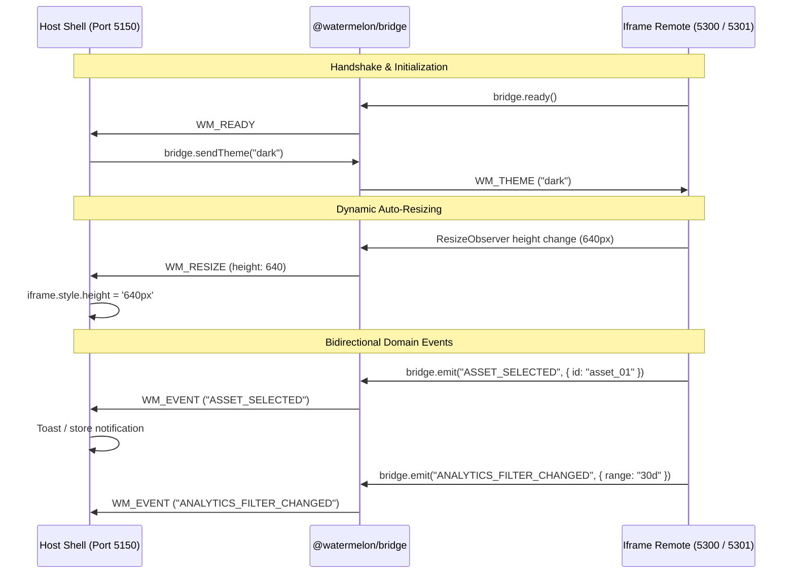

# Specification Document: Watermelon

Watermelon is a polyglot microfrontend architecture monorepo that orchestrates **12 independent web applications and packages** spanning three distinct microfrontend paradigms: **Module Federation, W3C Web Components, and Sandboxed Iframes**. It demonstrates enterprise-grade runtime federation, bidirectional Shadow DOM style isolation, decoupled adapter strategies, typed postMessage communication, and ultra-efficient developer tooling.

---

## 1. Core Architecture

### Frontend Stack & Paradigms
*   **Host Framework**: Vue 3.5 (Composition API & `<script setup>`) + TypeScript + Vite 6
*   **Host State Management**: Pinia (`navbarStore.ts`)
*   **Host Routing**: Vue Router 4 (HTML5 History Mode with dynamic wildcard subrouting)
*   **Host Styling**: Tailwind CSS v4, PrimeVue (Aura Preset), PrimeIcons, Custom CSS
*   **Integration Paradigm 1: Module Federation**:
    *   **Vite Remotes**: `@originjs/vite-plugin-federation` (ESM native federation).
    *   **Webpack Remotes**: Webpack 5 `ModuleFederationPlugin` (`libraryTarget: "var"` / `format: "var"` cross-bundler bridging).
*   **Integration Paradigm 2: W3C Web Components**:
    *   **Angular Remote**: `@angular/elements` (W3C Custom Element `<angular-remote-app>` with Zoneless change detection).
    *   **Lit Remote**: Lit 3.3 `<wm-notification-center>` W3C Custom Element with native Shadow DOM.
    *   **Vue CE Remote**: Vue 3.5 `defineCustomElement` `<wm-user-profile>` with reactive attribute reflection.
*   **Integration Paradigm 3: Sandboxed Iframes**:
    *   **Vite SPA Iframe**: React 19 standalone application running inside an isolated browsing context.
    *   **Next.js 16 Iframe**: Next.js App Router application with Turbopack and static page export.
*   **Cross-Boundary Communication Bus**:
    *   `@watermelon/bridge` (`packages/watermelon-bridge`): Zero-dependency typed postMessage communication bus for host-remote coordination.

### Network, Ports & Orchestration
All microfrontends serve over local HTTPS with shared trusted certificates (`certs/localhost.pem` and `certs/localhost-key.pem` generated via `mkcert`):

| App Identifier | Directory | Port | Strategy | Primary Framework | Bundler |
| :--- | :--- | :--- | :--- | :--- | :--- |
| **`host`** | `vite-hostapp` | `5150` | Host Orchestrator | Vue 3.5 | Vite 6 |
| **`v-react`** | `vite-remoteapp-1` | `5251` | Module Federation | React 19.1 | Vite 6 |
| **`v-vue`** | `vite-remoteapp-2` | `5252` | Module Federation | Vue 3.5 | Vite 6 |
| **`v-svelte`** | `vite-remoteapp-3` | `5253` | Module Federation | Svelte 5.0 | Vite 6 |
| **`v-solid`** | `vite-remoteapp-4` | `5254` | Module Federation | SolidJS 1.9 | Vite 6 |
| **`w-react`** | `webpack-remoteapp-1` | `5161` | Module Federation | React 19 | Webpack 5.98 |
| **`w-vue`** | `webpack-remoteapp-2` | `5162` | Module Federation | Vue 3.5 | Webpack 5.98 |
| **`angular`** | `angular-remoteapp` | `4201` | Web Component | Angular 20.3 | Angular CLI (esbuild) |
| **`wc-lit`** | `wc-lit-app` | `5302` | Web Component | Lit 3.3 | Vite 6 (Library mode) |
| **`wc-vue`** | `wc-vue-app` | `5303` | Web Component | Vue 3.5 CE | Vite 6 (Library mode) |
| **`iframe-vite`** | `iframe-vite-app` | `5300` | Sandboxed Iframe | React 19 | Vite 8 |
| **`iframe-nextjs`**| `iframe-nextjs-app` | `5301` | Sandboxed Iframe | Next.js 16 | Turbopack / Next export |

---

## 2. Microfrontend Inventory & Federation Details

### 1. `vite-hostapp` (Host Shell)
The central orchestrator and layout shell for the entire microfrontend platform.
*   **Port**: `5150` (HTTPS)
*   **Responsibilities**: Global navigation, theme synchronization, dynamic remote routing, and lifecycle teardown.
*   **Shared Dependencies**: `["react", "react-dom", "vue", "vue-router"]` (declared in `vite.config.ts`).

### 2–5. Vite Module Federation Remotes
*   **`vite-remoteapp-1`** (React 19, Port `5251`): Product catalog with interactive cart state. Uses `injectCssIntoJs` Vite plugin.
*   **`vite-remoteapp-2`** (Vue 3, Port `5252`): Subrouted dashboard with localized sub-navigation and `window.BASENAME` injection.
*   **`vite-remoteapp-3`** (Svelte 5, Port `5253`): Compile-time rune reactivity with Svelte 4/5 API compatibility.
*   **`vite-remoteapp-4`** (SolidJS, Port `5254`): Fine-grained signals with `solidDisposer` unmount tracking.

### 6–7. Webpack 5 Module Federation Remotes
*   **`webpack-remoteapp-1`** (React 19, Port `5161`): Demonstrates Vite-to-Webpack cross-bundler federation using `format: "var"`.
*   **`webpack-remoteapp-2`** (Vue 3, Port `5162`): Scoped SCSS modules and TypeScript support over Webpack 5.

### 8–10. W3C Web Component Remotes
*   **`angular-remoteapp`** (Angular 20, Port `4201`): Zoneless Angular Custom Element `<angular-remote-app>` containing a 17-topic developer cheat sheet.
*   **`wc-lit-app`** (Lit 3, Port `5302`): W3C Custom Element `<wm-notification-center>` built with Lit 3. Demonstrates reactive properties, badge count indicators, native Shadow DOM styles, and custom event dispatches (`wm-clear-all`).
*   **`wc-vue-app`** (Vue 3 Custom Element, Port `5303`): Built using Vue's `defineCustomElement` as `<wm-user-profile>`. Exposes reactive attributes (`user-name`, `user-role`, `status`, `theme`), internal status toggling, and dispatches Custom Events (`wm-signout`).

### 11–12. Sandboxed Iframe Remotes
*   **`iframe-vite-app`** (React 19, Port `5300`): Asset / Media Manager remote running inside an isolated `<iframe>`. Demonstrates internal client-side deep routing (`/detail/:id`), `ResizeObserver` auto-height sync, host theme inheritance, typed `ASSET_SELECTED` event emission, and crash isolation via `RemoteErrorBoundary`.
*   **`iframe-nextjs-app`** (Next.js 16, Port `5301`): Analytics & Telemetry Dashboard built with Next.js App Router and Turbopack. Uses `output: "export"` for high-performance static serving. Emits `ANALYTICS_FILTER_CHANGED` telemetry events and demonstrates fault containment.

---

## 3. Host Architecture & Refactored Adapter Pattern

To maintain clean code architecture and eliminate file bloat, `RemoteWrapper.vue` delegates framework-specific behavior to an **Adapter Pattern**:

```
RemoteWrapper.vue (~180 lines)
  │
  ├── shadow/
  │     ├── buildShadow.ts          (Shadow root creation & mount point setup)
  │     ├── patchHeadToShadow.ts    (Runtime DOM head style interception)
  │     └── cssCache.ts             (Module-level persisted style cache)
  │
  └── adapters/
        ├── BaseAdapter.ts          (RemoteAdapter interface contract)
        ├── ModuleFederationAdapter.ts (React, Vue, Svelte, SolidJS, Webpack)
        ├── WebComponentAdapter.ts  (Angular, Lit, Vue Custom Elements)
        └── IframeAdapter.ts        (Vite SPA, Next.js App Router + Bridge)
```

### Remote Adapter Lifecycle Contract

```typescript
export interface RemoteAdapterConfig {
  mountPoint: HTMLElement;
  shadowRoot: ShadowRoot;
  appName: string;
  basename: string;
  isCancelled?: () => boolean;
}

export interface RemoteAdapter {
  readonly strategy: "module-federation" | "web-component" | "iframe";
  mount(config: RemoteAdapterConfig): Promise<void>;
  unmount(): void;
}
```

### Adapter Implementations:

1.  **`ModuleFederationAdapter`**:
    *   Patches `document.head` to intercept injected CSS styles into the remote's Shadow DOM.
    *   Dynamically imports the remote component factory from `@originjs/vite-plugin-federation`.
    *   Mounts the framework component (`createRoot`, `createApp`, `mount`, or `render`) and tracks unmount hooks.
2.  **`WebComponentAdapter`**:
    *   Dynamically loads the remote bundle via `<script type="module" src="...">`.
    *   Instantiates the custom element (e.g., `<wm-notification-center>`, `<wm-user-profile>`), binds reactive attributes, and listens to custom events.
3.  **`IframeAdapter`**:
    *   Constructs an isolated `<iframe>` with `Content-Security-Policy: frame-ancestors 'self' https://localhost:5150 *`.
    *   Instantiates `WatermelonBridgeHost` to establish the bidirectional postMessage bus.

---

## 4. Cross-Boundary Communication Protocol (`@watermelon/bridge`)

Sandboxed iframes communicate with the host shell via `@watermelon/bridge` over `window.postMessage`:

### Message Structure:
```typescript
export interface WatermelonMessage<T = unknown> {
  source: "watermelon-bridge";
  channel: "watermelon:bridge";
  type: WatermelonMessageType;
  remoteId: string;
  payload?: T;
  timestamp: number;
}
```

### Protocol Interaction Flow:



---

## 5. Development & Performance Optimization

### Memory Optimization & Dev Strategies
Booting 11 live dev servers concurrently would consume **over 5 GB of RAM**. Watermelon solves this via two execution strategies:

#### Strategy A: Selective Live Dev Runner (`scripts/dev.sh`)
Launches the host shell alongside only the specific remote being modified (~350–650 MB RAM):
```bash
npm run dev:angular         # Host + Angular 20
npm run dev:react           # Host + Vite React
npm run dev:wc-lit          # Host + Lit Web Component
npm run dev:wc-vue          # Host + Vue Custom Element
npm run dev:iframe-vite     # Host + Vite Iframe
npm run dev:iframe-nextjs   # Host + Next.js Iframe
```

#### Strategy B: Unified Static Remote Server (`scripts/serve-remotes.mjs`)
Serves all 10 prebuilt remote applications (`dist/` or `out/` directories) using a single zero-dependency Node.js HTTPS server:
*   **Total RAM Usage**: **~57 MB** for all 10 remotes combined.
*   **Universal Headers**: Injects `Access-Control-Allow-Origin: *` and `Content-Security-Policy: frame-ancestors 'self' https://localhost:5150 *`.
*   **SPA Fallback**: Automatically serves `index.html` on subroute requests.

---

## 6. Testing & Quality Assurance

Watermelon enforces 100% automated test coverage across all federation paradigms:

*   **Static Type Checking**: `scripts/typecheck-all.sh` runs `vue-tsc`, `tsc`, and `svelte-check` across all 11 applications.
*   **Automated Production Builds**: `scripts/build-all.sh` compiles all 11 applications.
*   **End-to-End Test Suite**: `e2e/federation.spec.ts` executes 15 Playwright tests:
    1.  Host home dashboard and navigation.
    2.  Remote gallery cataloging all 10 remotes.
    3–12. Clean mounting and Shadow DOM rendering across all 10 remotes.
    13. Iframe Asset Manager navigation, bridge postMessage emission, and crash recovery.
    14. Next.js Analytics Dashboard range filtering, bridge event emission, and error containment.
